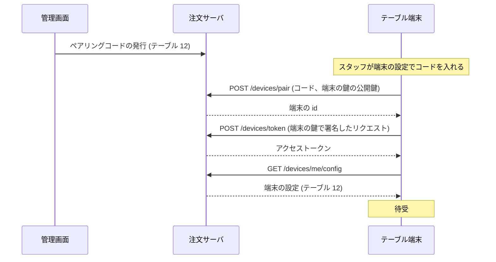
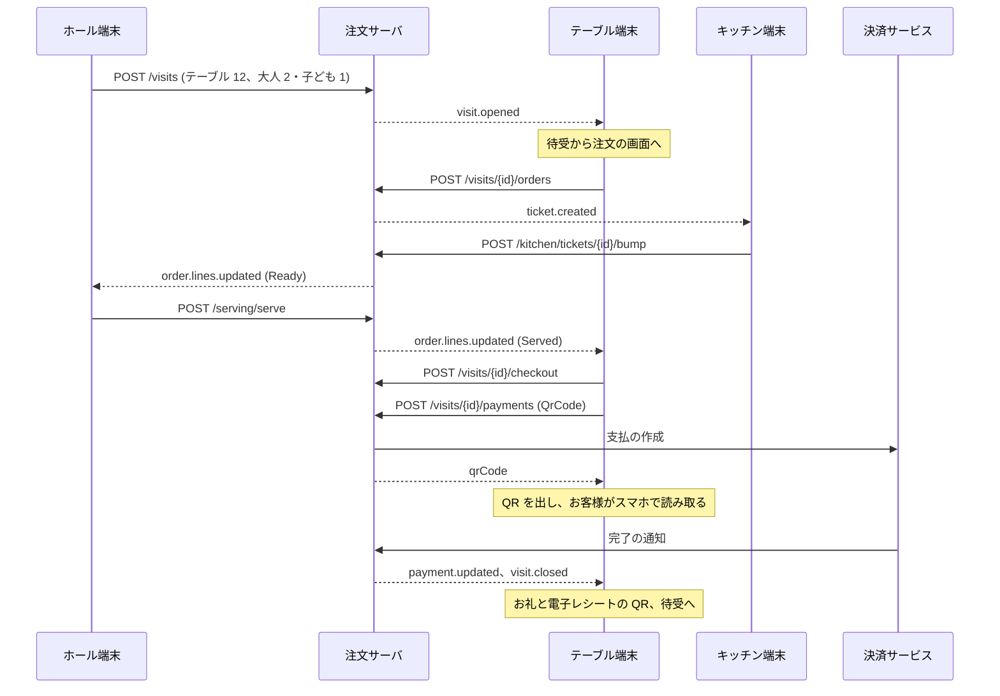

# 業務の前提と流れ

注文サーバと店の端末が前提にする業務 (店、端末、来店、会計) と、業務の流れ。  
API は [api-design.md](api-design.md)、データベースは [database.md](database.md)、構成は [architecture.md](architecture.md)、端末の配布は [device-management.md](device-management.md) を参照。

- [1. 前提](#-1-前提)
- [2. 端末と業務](#-2-端末と業務)
- [3. 来店](#-3-来店)
- [4. 業務の流れ](#-4-業務の流れ)
- [5. 金額と税](#-5-金額と税)
- [6. 扱わないもの](#-6-扱わないもの)

---

## 📐 1. 前提

| 項目 | 内容 |
| --- | --- |
| 業態 | ファミリーレストランのチェーン。店内飲食だけ |
| 範囲 | 注文と、注文に関わる店内の業務 (来店の開始、調理、提供、呼び出し、品切れ、テーブルでの会計) |
| テナント | 複数の会社が契約して使う。テナントの中に店舗を持ち、端末は 1 つの店舗に属する ([API のテナント](api-design.md#16-テナント)) |
| 利用者 | テーブル端末 (お客様)、ホール端末 (スタッフのハンディ)、キッチン端末 (KDS)、受付機 (任意)、外部 (本部の管理システム、POS、決済サービス) |
| 管理画面 | 店舗と端末の設定を行う (サーバの中の Web の画面) |
| 来店 | テーブルの開始から会計までを 1 つの来店とし、その中に注文が何回か入る。人数は来店に持つ |
| 金額 | 価格は税込 (総額表示)。店内飲食の税率 10% で、会計のときに税率ごとに税額を出す ([5. 金額と税](#-5-金額と税)) |
| 会計 | テーブル端末で行う (QR コード決済、クレジットカード)。現金はレジ |
| 言語 | 日本語と英語。メニューの名前と説明、呼び出しの用件は両方の言語で返す |
| 特例 | ドリンクバー、お酒、キッズ、数量限定、時間帯 (朝やランチ) などは、商品とオプションのタグとメニューのルールで表す ([API のメニュー](api-design.md#23-メニュー-menu)) |
| 通知 | 状態の変化は、サーバから端末へすぐに通知する ([API の通知](api-design.md#-3-リアルタイム通知)) |

---

## 🧩 2. 端末と業務

| 端末 | 使う人・置き場所 | 業務 |
| --- | --- | --- |
| テーブル端末 | お客様 (各テーブル) | メニューを見る、注文、注文履歴、食後の品のお願い、店員の呼び出し、テーブルでの会計、来店の開始 (来店の開き方が席の店) |
| ホール端末 | ホールのスタッフ (スマートフォン) | 来店の開始 (人数)、人数の変更、テーブルの移動、呼び出しの対応、提供、取消、品切れ、注文の一時停止、代理注文、レジで払った来店の終了 |
| キッチン端末 | 厨房・デザート・ドリンクの持ち場 | チケットの表示、作り始め・できあがり・下げる、品切れ |
| 受付機 (任意) | お客様 (入口) | 人数を入れて来店を開き、席を案内する (来店の開き方が受付機の店。席はサーバが空席から決める) |
| 外部 | 本部の管理システム、POS、決済サービス | メニューの公開、来店の明細と支払の受け取り、決済の完了の通知 |
| 管理画面 | 店長・本部・サービスの運営者 (サーバの中の Web の画面) | 店舗設定、テーブル、端末の登録と割り当て、店内状況、利用者、外部のクライアントと Webhook ([管理画面](#管理画面)) |

- ホール端末の代理注文では、確認のルールをスタッフがお客様に確認して記録する

### 管理画面

管理画面はサーバ (`TableOrder.Server.Web`) の中の Web の画面で、API を通さずに業務の処理を直接呼ぶ。  
利用者はメールアドレスとパスワードでサインインする (多要素認証を使うなら、認証アプリのコードも入れる)。

| 役割 | 範囲 | できること |
| --- | --- | --- |
| 運営者 | すべてのテナント (テナントを選んで扱う) | テナントの登録と停止、運営者の管理 |
| テナント管理者 | 属するテナントのすべての店舗 | チェーンの設定、店舗の追加、利用者の管理 |
| 店舗担当者 | 担当店舗だけ | 店内状況、テーブル、端末、店舗設定 |

| 画面 | できること |
| --- | --- |
| チェーン | チェーンの名前、ロゴ、色 (テナントのすべての店舗のテーブル端末に出す) |
| 店舗 | 店舗の追加と利用停止、営業時間とラストオーダー、注文の上限、支払方法、呼び出しの用件、電子レシート (事業者名と登録番号)、機能の有無、言語、スタッフ PIN |
| テーブル | 追加、名前、席数、表示順、利用停止 |
| 端末 | ペアリングコードと登録トークンの発行、置き場所 (テーブル、持ち場) の割り当て、無効化、状態 (電池残量、最終通信、アプリのバージョン) |
| 外部 | 外部のクライアントの発行・シークレットの再発行・取り消し、Webhook の送り先と配信状況 (あきらめた配信の再送) |
| 店内状況 | テーブルと来店、注文と明細の状態、呼び出し、品切れ、通知履歴。来店登録 (人数)、レジ会計済み、来店取消 |
| 利用者 | テナントの利用者の追加、役割と担当店舗、仮パスワードの再発行、多要素認証の解除、停止 |
| 自分のアカウント | パスワードの変更、多要素認証 (認証アプリ) の登録と解除 |
| テナント (運営者だけ) | テナントの登録と停止 |

- 店舗の機能の有無: お会計のレジ払い、割り勘、ラストオーダーのお知らせ、お礼の画面の表示時間、キッチンの遅れの警告
- 店内状況の来店登録・レジ会計済み・来店取消は、ホール端末が使えないときに使う (ホール端末と同じ処理)

---

## 🪑 3. 来店

### 3.1 来店と人数

来店の開き方は店舗の設定で選ぶ。  
どの開き方でも、ホール端末から来店を開ける (席の決め直しや、困ったときのため)。

| 来店の開き方 | 流れ |
| --- | --- |
| スタッフ (既定) | 入口でスタッフが人数を聞いて席を決め、ホール端末で来店を開く |
| 受付機 | お客様が受付機で人数を入れる。サーバが人数の入る空席を決めて来店を開き、受付機が席を案内する |
| 席 | お客様が空いている席に座り、テーブル端末の待受で人数を入れて始める |

- 受付機の店
  - 空席がなければ満席を出し、スタッフが引き継ぐ
  - ラストオーダーの時刻を過ぎたら受け付けない
  - 注文の一時停止の間も受け付ける (入口でお客様を止めない)。  
    席で注文を待つことを、受付の前と案内で表示する
- 人数は来店を開くときに入れる
- 来店がテーブルに結び付くと、テーブル端末は待受から注文の画面になる
- テーブル端末の登録 (一度だけ。端末を店舗とテーブルに結び付ける) と、来店の開始 (来店ごと) は別のもの
- ホール端末が使えないときは、管理画面の店内状況で来店を開き、閉じる (ホール端末と同じ処理)
- 人数の使い道
  - 客数 (客単価の分母)
  - ドリンクバーの人数分の提案
  - キッズメニューの表示 (子どもがいる来店だけに出す)
  - 割り勘の目安

### 3.2 来店の状態

```
(なし) --来店の開始--> Open --会計を始める--> Paying --支払が揃う--> Closed
                        ^                        |
                        +------会計をやめる-------+
Open --注文のないまま帰った--> Cancelled
Open / Paying --レジで払った (ホール / POS)--> Closed
```

- テーブル端末は、自分のテーブルに `Open` か `Paying` の来店があるときだけ注文の画面を出す。  
  ないときは待受にする
- `Paying` の間は注文を受け付けない (会計の明細が変わらないように)

---

## 🔁 4. 業務の流れ

### 4.1 端末を置くまで



- EMM で配布するときは、ペアリングコードの代わりに登録トークンを管理対象の構成で配信する。  
  端末は起動したときに、登録トークンで自分で登録する。  
  テーブルは管理画面で割り当て、端末は割り当てを待ってから待受になる
- 登録トークンは、店舗と種類に限り、台数と期限を決めて発行する
- 席替えで端末を別のテーブルに置くときは、管理画面で割り当てを変更する (端末は再登録しない)
- 種類の違うコードやトークンでは登録しない (ホール端末のコードをテーブル端末に入れるなど)。  
  このときコードは使用済みにならない
- 同じ端末を別のコードで再登録すると、新しい登録で使い始めたときに前の登録が無効になる (前のテーブルや店舗に端末が残らない)

端末を無効にしたときと、テナントを停止したとき:

| 操作 | 端末の動き |
| --- | --- |
| 端末を無効にする | 登録を消して、端末の設定に戻る |
| テナントを停止する | 起動の画面に停止中であることを出し、再開を待つ。5 分ごとに再確認し、スタッフが「もう一度試す」を押すとすぐに確認する |

どちらの場合も、サーバは端末が使っているトークンをすぐに拒否し、通知の接続を切断する。

### 4.2 着席から会計まで



図は、来店の開き方がスタッフの店の場合。  
ほかの開き方では `POST /visits` を送る端末だけが違い、そのあとの流れは同じ。

| 来店の開き方 | `POST /visits` を送る端末 |
| --- | --- |
| スタッフ | ホール端末 (図) |
| 受付機 | 受付機。テーブルを省いて送り、席はサーバが決める |
| 席 | テーブル端末。待受で送る |

- 食後の品は、お客様 (注文履歴) かホール (来店の詳細) がお願いするまでキッチンに出さない
- 会計を始めると、まだお願いしていない食後の品をすべてお願いする (払い終えると来店が閉じ、あとからお願いできないため)
- 払い終えて閉じた来店の、未提供の品もキッチンは作り続ける。  
  ホール端末の提供の一覧には、その営業日のうちは会計済みの印を付けて出す (お席にお持ちする)
- レジで払った来店をホール端末や管理画面で閉じるときは、食後の品を自動ではお願いしない (お客様が帰っていることもある)。  
  お願いしていない食後の品があれば、閉じる確認に作らないことを表示する

---

## 🧮 5. 金額と税

- 価格は税込 (総額表示) で持ち、店内飲食の税率 10% で計算する
- 明細: `unitPrice = 商品の price + Σ オプションの priceDelta`、`amount = unitPrice × quantity`
- 会計: 税率ごとに `taxableAmount = Σ amount`、`taxAmount = 端数処理 (taxableAmount × rate ÷ (1 + rate))`。  
  内税で、端数処理は店舗の `taxRounding` (既定は切り捨て)
- 割り勘の目安: `base = Floor(total ÷ guests)`。  
  余りの `total − base × guests` 円を、先頭の人から 1 円ずつ足す
- 端末は表示のために同じ計算をする。  
  サーバは注文と会計で再計算して検証する
- 電子レシート
  - テーブルで払い終えた来店に作る。  
    お客様は、お礼の画面の QR から自分のスマートフォンで開く
  - 出すもの: 事業者の名前と登録番号、払い終えた日時、明細、税率ごとの対象額と税額、合計、支払
  - 適格簡易請求書にする。  
    登録番号のない店は、登録番号のないレシートになる
  - 事業者は店舗の設定に持つ。  
    電子レシートには作ったときの値を残す (あとで設定を変更しても、出したレシートは変わらない)

計算例 (大人 2・子ども 1):

| 明細 | 単価 | 数量 | 金額 |
| --- | ---: | ---: | ---: |
| チーズインハンバーグ (999) + ライス・スープ (330) + セットドリンクバー (299) | 1,628 | 2 | 3,256 |
| いちごパフェ (食後) | 699 | 1 | 699 |
| ドリンクバー (単品) | 459 | 1 | 459 |
| 合計 | | | 4,414 |

- 税 (内税 10%): `Floor(4,414 × 0.10 ÷ 1.10)` = 401
- 割り勘の目安 (3 人): `Floor(4,414 ÷ 3)` = 1,471、余り 1 円 → 1,472 / 1,471 / 1,471
- ドリンクバー: `drink-bar` のタグの品は、セットのオプション 2 + 単品 1 = 3。  
  人数分あるので提案しない

---

## 🚫 6. 扱わないもの

POS の一般の業務と、注文に関わらない店舗・本部の業務は扱わない。  
注文サーバと連携するものは、連携の方法も書いた。

| 範囲 | 扱わないこと | 置き場所・連携 |
| --- | --- | --- |
| メニューのマスタ管理 | 商品・価格・写真・英語の訳の入力、時間帯の設定、店舗ごとの出し分け | 本部の管理システム。公開した結果を `POST /menu/publications` で受け取る |
| POS の一般の業務 | 売上の締め、日報、レジの開閉と現金、売上の分析 | POS。来店の明細と支払を Webhook (`visit.closed`) で渡す |
| 決済の処理 | 決済サービスとの契約と接続、カードの情報、返金、売上の確定 | 決済サービスと決済端末。注文サーバは支払の開始と結果の記録だけ |
| 現金の会計 | テーブルでの現金の受け渡し | レジで払い、POS かホール端末が来店を終える (`POST /visits/{id}/close`) |
| レシートと領収書の印刷 | 紙のレシート、宛名のある領収書 | 電子レシートの画面 (お客様のスマートフォンで見る) だけを出す。紙はレジ |
| 品ごとの割り勘 | 明細を人ごとに分けた会計 | 人数で割った目安と、額を分けた複数の支払だけ |
| 値引・クーポン・ポイント・会員 | 会員の認証、クーポン、ポイントの付与と利用 | 会員・販促のシステム (将来の拡張) |
| 予約・順番待ち | 受付の発券、順番の呼び出し、席が空くまでの待ち | 予約・受付のシステム。注文サーバは来店の開始 (受付機の店は空席の割り当てまで) だけ |
| 大人数の席 | 2 つ以上のテーブルをまとめて 1 つの来店で使う | スタッフが大きいテーブルに案内する (来店 1 つにテーブル 1 つ) |
| 持ち帰り・デリバリー・モバイルオーダー | お客様のスマートフォンからの注文、持ち帰りの税率 (8%) | 店内飲食 (10%) だけを扱う |
| 食材の在庫と発注 | 原材料の在庫、仕入れ | 品切れ (売れるかどうか) だけを扱う |
| スタッフの管理 | スタッフの登録、PIN、権限、勤怠 | 操作の記録に `staffId` を任意で付けるだけ |
| キッチンプリンタ | 伝票の印刷とプリンタの制御 | キッチン端末 (KDS) を前提にする |
| 配膳ロボット | 配膳の依頼と到着の連絡 | 将来の拡張 (できあがった明細を渡す形になる) |
| 時間制のコース | 食べ放題・飲み放題の制限時間 | ファミリーレストランでは使わない (ドリンクバーは時間を区切らない) |
| 分析・レポート | 時間帯の売れ方、提供までの時間、呼び出しの対応までの時間 | 通知と記録から別に集計する |
| テナントをまたぐもの | テナントをまたぐ集計、メニューや設定の共有、テナントの中のブランド・地域の階層 | テナントごとに閉じる。チェーンはテナントと同じ単位にし、名前・ロゴ・色はチェーンの設定で変更する |
