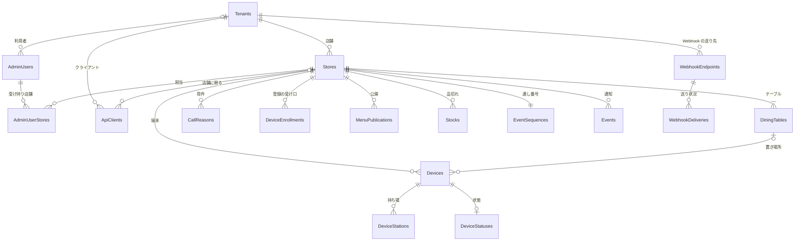
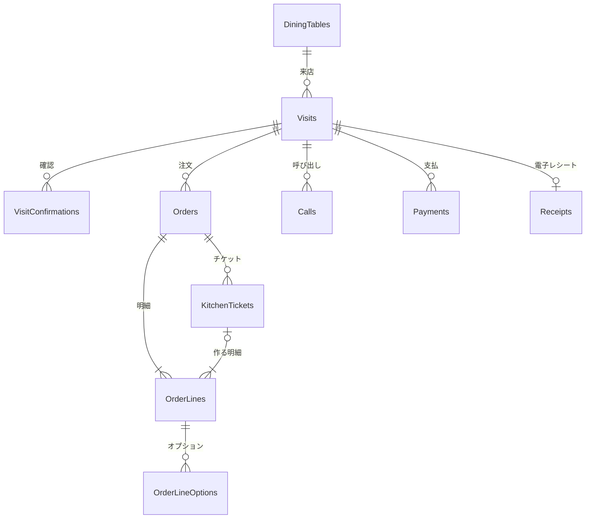

# データベース設計

注文サーバ (`TableOrder.Server.Core`) が持つデータの設計。  
スキーマ (`server/src/TableOrder.Server.Web/Assets/Data/Schema.sql`) は、この文書のすべての表を作る。  
サーバの起動のたびに実行する。  
外部連携の表 (`ApiClients`、`WebhookEndpoints`、`WebhookDeliveries`) は作成済み。  
読み書きは外部連携を作るときに追加する ([backlog.md](backlog.md))。  
業務の前提は [business.md](business.md)、API は [api-design.md](api-design.md) を参照。

- [1. 前提](#-1-前提)
- [2. 表の一覧](#-2-表の一覧)
- [3. テナントと店舗](#-3-テナントと店舗)
- [4. 端末と外部のクライアント](#-4-端末と外部のクライアント)
- [5. メニューと品切れ](#-5-メニューと品切れ)
- [6. 来店と注文](#-6-来店と注文)
- [7. 調理と呼び出し](#-7-調理と呼び出し)
- [8. 会計](#-8-会計)
- [9. 通知](#-9-通知)
- [10. 書き込みのルール](#-10-書き込みのルール)
- [11. 保持期間](#-11-保持期間)

---

## 📐 1. 前提

| 項目 | 内容 |
| --- | --- |
| データベース | 開発と今のサーバは SQLite。本番は Amazon RDS (エンジンと移行の方法は [plan.md](plan.md#-本番の環境)) |
| 型と SQL | ほかのデータベースに移しやすいもの (部分索引、`RETURNING`) にする |
| 範囲 | 複数のテナント (契約した会社) の店舗 ([api-design.md](api-design.md#16-テナント)) |
| テナントと店舗 | 全テナントを 1 つのデータベースに置き、表ごとに `TenantId` で分ける ([テナントの持ち方](#テナントの持ち方))。店舗ごとのデータは `StoreId` も持つ |
| 名前 | 表は複数形、列は PascalCase (行の型のプロパティと同じ名前) |
| テーブル (席) の表 | SQL の表と紛れないように `DiningTables` にする |
| 時刻 | UTC で持つ。サーバの時計で付け、端末の時刻は使わない |
| 営業時間 | 営業時間とラストオーダーは、店舗の現地時刻の `HH:mm` で持つ |
| 営業日 | 来店を開いたときに決めて持つ |
| 削除 | 業務のデータは削除せず、状態 (取消、無効) で表す。保持期間を過ぎたものだけを削除する ([§11](#-11-保持期間)) |
| 文字列の長さ | API の検証で確認する。データベースでは決めない |

データの正:

| データ | 正 |
| --- | --- |
| 来店、注文、調理、提供、呼び出し、テーブルでの会計 | このデータベース |
| メニュー | 本部の管理システム (公開された内容をコピーして持つ) |
| 売上 | POS |

型:

| 型 | SQLite | C# | 内容 |
| --- | --- | --- | --- |
| `guid` | TEXT | `Guid` | 小文字のハイフン付き (`D` 形式) |
| `string` | TEXT | `string` | |
| `int` | INTEGER | `int` / `long` | |
| `bool` | INTEGER | `bool` | `0` / `1` |
| `money` | NUMERIC | `decimal` | 円の整数。価格は税込 |
| `rate` | NUMERIC | `decimal` | `0.10` = 10% |
| `datetime` | TEXT | `DateTimeOffset` | UTC の `yyyy-MM-dd HH:mm:ss.fffffff` |
| `date` | TEXT | `DateOnly` | `yyyy-MM-dd` |
| `time` | TEXT | `string` | 店舗の現地時刻の `HH:mm` |
| `enum` | TEXT | 列挙型 | 列挙名 (`Open`) |
| `LocalizedText` | TEXT | `LocalizedText` | 言語ごとの文字列の JSON (`{"ja": "...", "en": "..."}`) |
| `json` | TEXT | 型ごと | まとめて読み書きするもの (公開されたメニュー、通知の `data`、値の一覧) |
| `bytes` | BLOB | `byte[]` | ハッシュ |

列の表の型の `?` は、null を許す列。

### テナントの持ち方

`Tenants` と `AdminUsers` (管理画面の利用者) のほかは、すべての表が `TenantId` を持つ。  
すべてのテナントのデータを 1 つのデータベースに置く。  
`AdminUsers` は運営者 (テナントに属さない) を含むので、`Tenants` と同じくテナントの外の表にする。  
`AdminUsers` では、テナントの利用者だけが `TenantId` を持つ。

- 読み書きは、リクエストのコンテキスト (トークン) のテナントで必ず絞る (`AND TenantId = ...`)
- すべての SQL にテナントの条件を書く。  
  書き忘れは、SQL のファイルを検査するテストで見つける
- 主キー・一意・索引は、先頭に `TenantId` を置く。  
  各表のキーと索引の箇条書きでは、`TenantId` を省いて書く。  
  主キーを書いていない表の主キーは `TenantId`、`Id`
- 外部キーも `TenantId` を含めて親の表を指す (子と親のテナントを食い違わせない)
- テナントのわからないリクエストで引く列は、`TenantId` を付けずに全テナントで一意にする
  - 端末の `Id`
  - ペアリングコード、登録トークン
  - クライアントの `Id`
  - 決済の取引番号
  - 電子レシートの `Token`
  - 管理画面の利用者のメールアドレス
- これらの列で引いた行のテナントを、その後の処理のコンテキストにする
- テナントをまたいで読むのは、バックグラウンド処理 (通知の配信、Webhook の再送、古いデータの削除) と運営者の管理画面だけ。  
  その SQL は置き場所を分け、テナントの条件を検査するテストから外す。  
  その索引には `TenantId` を付けない (`Events` の `OccurredAt`、`WebhookDeliveries` の `NextAttemptAt`)
- 本番のデータベースが行レベルセキュリティ (RLS) を持つなら、テナントの条件をデータベースでも適用する
- 大きなテナントを別のデータベースに移すときは、同じスキーマのデータベースにそのテナントの行を移す (`TenantId` で行を選べる)

---

## 📋 2. 表の一覧

| 区分 | 表 | 内容 | 書くところ |
| --- | --- | --- | --- |
| テナント | `Tenants` | 契約した会社 (利用可能、停止中、解約済み) | 運営者の管理画面 |
| 店舗 | `Stores` | 店舗と店舗の設定 (営業時間、注文の一時停止、注文の上限、支払方法、電子レシートの事業者) | 管理画面、`PUT /store/ordering` |
| | `CallReasons` | 呼び出しの用件 | 管理画面 |
| | `DiningTables` | テーブル (席) | 管理画面 |
| 管理画面 | `AdminUsers` | 管理画面の利用者 (役割、パスワードのハッシュ、多要素認証)。運営者はテナントに属さない | 管理画面 (サインイン、利用者の管理) |
| | `AdminUserStores` | 店舗担当者が受け持つ店舗 | 管理画面 |
| 端末 | `Devices` | 登録した端末 (種類、置き場所、公開鍵) | `POST /devices/pair`、管理画面 |
| | `DeviceStations` | キッチン端末が受け持つ持ち場 | `POST /devices/pair`、管理画面 |
| | `DeviceStatuses` | 端末の状態 (電池、アプリのバージョン、最終通信) | `POST /devices/me/heartbeat`、ハブの接続 |
| | `DeviceEnrollments` | ペアリングコードと登録トークン | 管理画面 (発行)、`POST /devices/pair` (使用) |
| 外部 | `ApiClients` | 外部 (本部、POS) のクライアント | 管理画面 |
| | `WebhookEndpoints` | Webhook の送り先 | 管理画面 |
| | `WebhookDeliveries` | Webhook の送り状況 | 通知の配信処理 |
| メニュー | `MenuPublications` | 本部が公開したメニュー (公開の内容をそのまま) | `POST /menu/publications` |
| | `Stocks` | 品切れと残数 (`Available` でないものだけ) | `PUT /stock/{targetId}`、`POST /stock/reset`、注文 |
| 来店 | `Visits` | 来店 (テーブル、人数、状態) | 来店の API、会計 |
| | `VisitConfirmations` | 確認のルールに答えた記録 | `POST /visits/{id}/confirmations` |
| 注文 | `Orders` | 注文 (1 回の確定) | `POST /visits/{id}/orders` |
| | `OrderLines` | 明細 (注文時の名前と価格、調理と提供の状態) | 注文、キッチン、提供、取消 |
| | `OrderLineOptions` | 明細で選んだオプション | 注文 |
| 調理 | `KitchenTickets` | 持ち場ごとのチケット | 注文、食後の品のお願い、キッチン |
| 呼び出し | `Calls` | 呼び出し | `POST /visits/{id}/calls`、ホール |
| 会計 | `Payments` | 支払 | `POST /visits/{id}/payments`、決済の結果 |
| | `Receipts` | 電子レシート | 支払が揃ったとき |
| 通知 | `EventSequences` | 店舗ごとの通知の通し番号 | 状態を変えるすべての書き込み |
| | `Events` | 通知 (再接続時のキャッチアップのために 24 時間保持) | 状態を変えるすべての書き込み |

`Tenants` はすべての表から指される。  
図には、テナントの直下の表への線だけを書く。

テナント・店舗・端末・メニュー:

来店から会計まで:

---

## 🏪 3. テナントと店舗

### Tenants (テナント)

| 列 | 型 | 内容 |
| --- | --- | --- |
| `Id` | guid | |
| `Code` | string | テナントのコード (運営と契約で使う) |
| `Name` | string | 会社の名前 (管理画面に表示) |
| `BrandName` | LocalizedText | チェーンの名前 (テーブル端末に表示) |
| `LogoImageName` | string? | ロゴの画像の名前。実体は画像の保存先に置く (正方形で背景色を含む) |
| `Theme` | json? | 変える色 (`[{ "role": "PrimaryColor", "color": "#1E5FA8" }]`)。ない役割は端末の既定 |
| `Status` | enum | `Active` / `Suspended` (契約を停止した) / `Closed` (解約した) |
| `SuspendedAt` / `ClosedAt` | datetime? | |
| `CreatedAt` / `UpdatedAt` | datetime | |
| `Version` | int | 管理画面の編集の楽観ロック |

- 主キー: `Id`
- 一意: `Code`
- この表だけは `TenantId` を持たない
- チェーンはテナントと同じ単位にする
- チェーンの設定 (`BrandName`、`LogoImageName`、`Theme`) を変更したら、テナントのすべての店舗の `SettingsVersion` を上げる
- サーバは停止したテナントの一覧をメモリに持ち、リクエストごとに拒否する。  
  `Status` を変更したら、一覧も更新する

### Stores (店舗)

| 列 | 型 | 内容 |
| --- | --- | --- |
| `TenantId` | guid | テナント (キーの先頭) |
| `Id` | guid | |
| `Code` | string | 店舗コード (POS と合わせる) |
| `Name` | LocalizedText | |
| `TimeZone` | string | `Asia/Tokyo` |
| `OpenTime` / `CloseTime` | time | 開店の時刻が営業日の区切り。閉店が開店より前なら日をまたぐ |
| `LastOrderTime` | time? | ラストオーダーのない店は null |
| `OrderingPaused` | bool | 注文の一時停止 |
| `PausedMessage` | LocalizedText? | 一時停止の間にテーブル端末に表示する文言 |
| `TaxRounding` | enum | `Floor` / `Round` / `Ceiling` |
| `MaxQuantityPerLine` / `MaxLinesPerOrder` | int | 1 明細の数量の上限と、1 回の注文の明細の数の上限 |
| `Languages` | json | 画面で選べる言語 (`["ja", "en"]`) |
| `PaymentMethods` | json | テーブルで使える支払方法 (`["QrCode", "CreditCard"]`) |
| `ElectronicReceipt` | bool | 電子レシートを発行するか |
| `IssuerName` | string? | 電子レシートに表示する事業者名 |
| `InvoiceRegistrationNumber` | string? | 適格請求書発行事業者の登録番号 (`T` と 13 桁の数字)。ない店の電子レシートは登録番号なし (適格簡易請求書ではない) |
| `Features` | json | 機能の有無 |
| `StaffPinHash` | json | スタッフの PIN のハッシュ (PBKDF2-HMAC-SHA256。`{ "iterations": 100000, "salt": "...", "hash": "..." }`)。平文は持たない |
| `SettingsVersion` | int | チェーンと店舗の設定のバージョン。端末が設定を再読み込みするかの判定に使う |
| `MenuPublicationId` | guid? | 今のメニュー |
| `IsActive` | bool | |
| `CreatedAt` / `UpdatedAt` | datetime | |
| `Version` | int | 管理画面の編集の楽観ロック (注文の一時停止では上げない) |

- 一意: `Code`
- `Features` は項目が増えていくので、列にせず JSON で持つ。  
  ない項目は既定の値にする。  
  例: `{ "registerCheckout": true, "splitPayment": true, "lastOrderNoticeMinutes": 30, "finishSeconds": 30, "visitOpening": "Hall", "kitchenAlertMinutes": 15, "daypartGraceMinutes": 2 }`
- `SettingsVersion` は、設定 (チェーン、店舗、テーブル) を変更するたびに上げる。  
  店舗の行の編集の `Version` とは分ける
- `GET /store` と `GET /devices/me/config` は、この行と `CallReasons` から作る。  
  端末の設定 (`GET /devices/me/config`) には、テナントのチェーンの設定も使う
- 営業日 (`businessDate`) は、今の時刻と `OpenTime` から求める

### CallReasons (呼び出しの用件)

| 列 | 型 | 内容 |
| --- | --- | --- |
| `TenantId` | guid | テナント (キーの先頭) |
| `StoreId` | guid | |
| `Code` | string | `Staff`、`Water` など |
| `Name` | LocalizedText | |
| `SortOrder` | int | |
| `IsActive` | bool | |

- 主キー: `StoreId`、`Code`

### DiningTables (テーブル)

| 列 | 型 | 内容 |
| --- | --- | --- |
| `TenantId` | guid | テナント (キーの先頭) |
| `Id` | guid | |
| `StoreId` | guid | |
| `Name` | string | `12` |
| `Area` | string? | `窓側`、`2F` |
| `Capacity` | int | 席数 |
| `SortOrder` | int | |
| `IsActive` | bool | false は使わなくなったテーブル (来店の記録が指すので削除しない) |
| `CreatedAt` / `UpdatedAt` | datetime | |
| `Version` | int | |

- 一意: `StoreId`、`Name`
- `GET /tables` の来店の要約 (`visit`) は、次から求める
  - 開いている来店
  - その来店の明細 (未提供の品)
  - その来店の呼び出し (終わっていないもの)

### AdminUsers (管理画面の利用者)

| 列 | 型 | 内容 |
| --- | --- | --- |
| `Id` | guid | |
| `TenantId` | guid? | 属するテナント (運営者は null) |
| `Role` | enum | `Operator` (運営者) / `TenantAdmin` (テナント管理者) / `StoreStaff` (店舗担当者) |
| `Email` / `NormalizedEmail` | string | サインインの名前 (メールアドレス) と、それを大文字にそろえたもの |
| `Name` | string | 表示名 |
| `PasswordHash` | string | パスワードのハッシュ (ASP.NET Core Identity の形式。PBKDF2)。平文は持たない |
| `MustChangePassword` | bool | 管理者が発行した仮パスワード (次のサインインで変更させる) |
| `SecurityStamp` | string | 資格情報を変更したら変える値 |
| `AccessFailedCount` / `LockoutEnd` | int / datetime? | 連続で間違えた回数と、ロックアウトの期限 (5 回で 15 分) |
| `TwoFactorEnabled` | bool | 多要素認証 (認証アプリ) を使う |
| `AuthenticatorKey` | string? | 認証アプリの鍵 (データ保護で暗号化したもの) |
| `RecoveryCodes` | json? | 回復コード (データ保護で暗号化したものの配列 `["..."]`)。使ったコードは除く |
| `LastSignInAt` | datetime? | |
| `IsActive` | bool | false は利用停止した利用者 (サインインできない。削除しない) |
| `CreatedAt` / `UpdatedAt` | datetime | |
| `Version` | int | 資格情報と管理画面の編集の楽観ロック |

- 主キー: `Id`
- 一意: `NormalizedEmail`。  
  サインインはテナントのわからないまま引くので、全テナントで一意にする
- 一意: `TenantId`、`Id` (`AdminUserStores` から指す)
- 運営者はテナントに属さないので、`Tenants` と同じくテナントの外の表にする
- サインインと自分の資格情報の読み書きは、利用者の `Id` かメールアドレスで引く
- テナントの利用者の一覧と管理は、テナントで絞る
- `SecurityStamp` は、資格情報 (パスワード、役割、担当店舗、多要素認証、利用停止) を変更したら変える。  
  開いている管理画面は、1 分以内にサインインからやり直しになる

### AdminUserStores (店舗担当者が受け持つ店舗)

| 列 | 型 | 内容 |
| --- | --- | --- |
| `TenantId` | guid | テナント (キーの先頭) |
| `UserId` | guid | 利用者 (店舗担当者) |
| `StoreId` | guid | 担当店舗 |

- 主キー: `UserId`、`StoreId`

---

## 📱 4. 端末と外部のクライアント

### Devices (端末)

| 列 | 型 | 内容 |
| --- | --- | --- |
| `TenantId` | guid | テナント (キーの先頭) |
| `Id` | guid | 登録のときにサーバが採番 |
| `StoreId` | guid | |
| `Kind` | enum | `Table` / `Hall` / `Kitchen` / `Reception` |
| `Name` | string | `T12`、`ハンディ 1`、`キッチン 1` |
| `TableId` | guid? | テーブル端末の置き場所 |
| `PublicKey` | string | 端末の公開鍵 (JWK)。トークンのリクエストの署名の検証に使う |
| `IsActive` | bool | 無効にすると、次のトークンを発行しない。発行したトークンもすぐに拒否する |
| `RegisteredAt` | datetime | |
| `RevokedAt` | datetime? | 無効にした時刻。トークンの期限を過ぎるまで、失効リストに入れる |
| `CreatedAt` / `UpdatedAt` | datetime | |
| `Version` | int | |

- 全テナントで一意: `Id` (トークンのリクエストで、テナントのわからないまま端末を引く)
- 索引:
  - `StoreId`
  - `RevokedAt` (無効にした行だけの部分索引): 失効リスト用に、テナントをまたいで最近無効にした端末を引く
  - `PublicKey`: 再登録した端末の前の登録を、テナントのわからないまま引く
- 公開鍵の JWK は、読み取った座標から書き直す (同じ鍵を同じ文字列にする)
- 同じ鍵で再登録した端末が新しい登録でトークンを受け取ると、前の登録 (同じ `PublicKey` の有効な行) を無効にする
- 名前は端末が送った名前 (機種の名前と、端末ごとの値の末尾)。  
  重複してよい (管理画面で変更する)
- 置き場所 (テーブル、持ち場) を変更しても再登録しない。  
  変更は、次のトークンと端末の設定に反映される

### DeviceStations (キッチン端末の持ち場)

| 列 | 型 | 内容 |
| --- | --- | --- |
| `TenantId` | guid | テナント (キーの先頭) |
| `DeviceId` | guid | |
| `StationId` | guid | メニューの持ち場 (`stations`) の Id |

- 主キー: `DeviceId`、`StationId`
- 持ち場はメニューと一緒に本部が決める。  
  そのため表にせず、公開されたメニューの Id を指す
- 本部はメニューを再公開しても、持ち場の Id を変えない

### DeviceStatuses (端末の状態)

| 列 | 型 | 内容 |
| --- | --- | --- |
| `TenantId` | guid | テナント (キーの先頭) |
| `DeviceId` | guid | |
| `AppVersion` | string? | |
| `BatteryLevel` | rate? | 電池の残量 (`0`〜`1`) |
| `IsCharging` | bool? | |
| `LastSeenAt` | datetime | 最後に通信した時刻。状態の報告とハブの接続で更新する (リクエストごとには書かない) |

- 主キー: `DeviceId`
- 1 分ごとに書くので、端末の表と分ける (管理画面の編集の楽観ロックと競合させない)

### DeviceEnrollments (端末の登録の受け口)

| 列 | 型 | 内容 |
| --- | --- | --- |
| `TenantId` | guid | テナント (キーの先頭) |
| `Id` | guid | |
| `StoreId` | guid | |
| `Kind` | enum | 登録する端末の種類 |
| `Method` | enum | `PairingCode` / `EnrollmentToken` |
| `PairingCode` | string? | 6 桁の数字 (短命なので平文で持つ) |
| `TokenHash` | bytes? | 登録トークンの SHA-256 |
| `TableId` | guid? | ペアリングコードで決めるテーブル |
| `StationIds` | json? | ペアリングコードで決める持ち場 |
| `MaxUses` / `UsedCount` | int | 登録できる台数と、登録した台数 |
| `ExpiresAt` | datetime | |
| `CreatedAt` | datetime | |
| `RevokedAt` | datetime? | 登録トークンを取り消した時刻 |

登録の方法 (`Method`):

| 方法 | 発行 | 期限 | 台数 |
| --- | --- | --- | --- |
| `PairingCode` | 管理画面で発行する 6 桁 | 10 分 | 1 台 |
| `EnrollmentToken` | EMM で配信する | 数日 | 決めた台数まで |

- 全テナントで一意 (null でない行だけ):
  - `PairingCode`
  - `TokenHash`
- ペアリングのリクエストは、テナントも店舗も持たない。  
  コードから引いた行のテナントと店舗で、端末を登録する
- 期限を過ぎたコードは削除する (同じコードを再発行できるように)
- 登録トークンは、期限を過ぎるか取り消してから 1 日で削除する (それまでは管理画面の一覧に表示する)

### ApiClients (外部のクライアント)

| 列 | 型 | 内容 |
| --- | --- | --- |
| `TenantId` | guid | テナント (キーの先頭) |
| `Id` | guid | `client_id` |
| `Name` | string | `本部`、`001 の POS` |
| `StoreId` | guid? | 店舗に限るクライアント (POS)。null はテナント全体 (本部) |
| `SecretHash` | bytes | `client_secret` の SHA-256 |
| `Scopes` | json | 使えるスコープ (`menu.publish`、`visits.read`、`visits.close` など) |
| `IsActive` | bool | |
| `CreatedAt` | datetime | |
| `RevokedAt` | datetime? | |

- 全テナントで一意: `Id` (client credentials で、テナントのわからないままクライアントを引く)
- アクセストークンは `POST /oauth/token` (client credentials) で発行する
- `client_secret` はハッシュだけを持つ
- Webhook の送り先と送り状況は [§9](#-9-通知) を参照

---

## 📖 5. メニューと品切れ

### MenuPublications (メニューの公開)

| 列 | 型 | 内容 |
| --- | --- | --- |
| `TenantId` | guid | テナント (キーの先頭) |
| `Id` | guid | |
| `StoreId` | guid | |
| `MenuVersion` | string | 公開ごとに変わる値 (公開の時刻と通し番号。`2026-10-01T02:00:00.000Z-17`)。`GET /menu` の `ETag` |
| `Content` | json | 公開されたメニュー (`MenuResponse` の形)。時間帯と出せる条件のルールも含む |
| `PublishedAt` | datetime | |
| `ApiClientId` | guid? | 公開した外部のクライアント |

- 一意: `StoreId`、`MenuVersion`
- メニューは本部が編集して丸ごと公開する。  
  そのため商品やオプションの表に分けず、公開の内容をそのまま持つ
- サーバは店舗の今のメニューをメモリに読み込む (公開で差し替える)。  
  読み込んだメニューは、`GET /menu` と注文の検証 (価格、オプション、タグとルール、持ち場) に使う
- 料理の写真は、画像の保存先 (テナントごと) に置く。  
  保存先は、開発はファイル、本番は Amazon S3
- データベースには、メニューの `imageName` (画像の名前) だけを持つ

### Stocks (品切れ)

| 列 | 型 | 内容 |
| --- | --- | --- |
| `TenantId` | guid | テナント (キーの先頭) |
| `StoreId` | guid | |
| `TargetId` | guid | 商品かオプションの Id |
| `TargetKind` | enum | `Item` / `Option` |
| `Status` | enum | `Limited` / `SoldOut` |
| `Remaining` | int? | `Limited` の残数 |
| `UpdatedAt` | datetime | |

- 主キー: `StoreId`、`TargetId`
- `Available` に戻したら行を削除する
- `GET /stock` は行をそのまま返す
- メニューの公開でなくなった商品とオプションの行も削除する
- 残数は、注文を受けるときに `Remaining >= 数量` を条件に減らす。  
  `0` になったら `SoldOut` にする (同時の注文でも残数を超えない)

---

## 🪑 6. 来店と注文

### Visits (来店)

| 列 | 型 | 内容 |
| --- | --- | --- |
| `TenantId` | guid | テナント (キーの先頭) |
| `Id` | guid | 来店を開いた端末が採番 (管理画面の案内ではサーバ) |
| `StoreId` | guid | |
| `TableId` | guid | 移動で変わる |
| `BusinessDate` | date | 開いたときの営業日 |
| `Adults` / `Children` | int | 合計で 1 以上 |
| `Status` | enum | `Open` / `Paying` / `Closed` / `Cancelled` |
| `OpenedBy` | enum | `Hall` (ホール端末と管理画面の案内) / `Reception` (受付機) / `Table` (テーブル端末) |
| `OpenedDeviceId` | guid? | 開いた端末 (管理画面の案内は null) |
| `OpenedAt` | datetime | |
| `ClosedBy` | enum? | `TablePayment` / `Register` / `Hall` |
| `ClosedAt` | datetime? | 閉じたか取りやめた時刻 |
| `ClosedStaffId` | string? | 閉じたスタッフ (任意。取りやめでは書かない) |
| `CreatedAt` / `UpdatedAt` | datetime | |
| `Version` | int | 来店の変更 (人数、移動、会計、閉じる、取りやめ) の楽観ロック。確認の記録では上げない |

- 一意: `TableId` (`Status` が `Open` か `Paying` の行だけの部分索引)。  
  1 つのテーブルに開いている来店を 2 つ作らない (`TABLE_OCCUPIED`)
- 索引: `StoreId`、`BusinessDate`
- `VisitResponse` の項目は、次の表から求める
  - `tableName`: `DiningTables`
  - `confirmedRuleIds`: `VisitConfirmations`
  - `orderTotal`: `OrderLines` (取消を除く)

### VisitConfirmations (確認の記録)

| 列 | 型 | 内容 |
| --- | --- | --- |
| `TenantId` | guid | テナント (キーの先頭) |
| `VisitId` | guid | |
| `RuleId` | guid | メニューの確認のルールの Id |
| `DeviceId` | guid? | 回答した端末 |
| `ConfirmedAt` | datetime | |

- 主キー: `VisitId`、`RuleId`

### Orders (注文)

| 列 | 型 | 内容 |
| --- | --- | --- |
| `TenantId` | guid | テナント (キーの先頭) |
| `Id` | guid | 送信した端末が採番 |
| `StoreId` | guid | |
| `VisitId` | guid | |
| `OrderNo` | int | 来店の中の通し番号 |
| `Source` | enum | `Table` / `Hall` |
| `DeviceId` | guid? | 送信した端末 |
| `MenuVersion` | string | 表示していたメニュー |
| `RequestHash` | bytes | リクエストの内容のハッシュ。同じ `id` で内容の違う再送を見つける |
| `OrderedAt` | datetime | |

- 一意: `VisitId`、`OrderNo`
- `OrderNo` は、店舗の書き込みのロックの中で、来店の最大の番号に 1 を足して採番する。  
  店舗の書き込みは 1 つずつなので重複しない
- 注文の合計 (`amount`) は列に持たず、明細 (取消を除く) から求める

### OrderLines (明細)

| 列 | 型 | 内容 |
| --- | --- | --- |
| `TenantId` | guid | テナント (キーの先頭) |
| `Id` | guid | 送信した端末が採番。数量の一部を取り消して分けた明細は、サーバが採番 |
| `StoreId` | guid | |
| `OrderId` | guid | |
| `VisitId` | guid | 来店の明細をまとめて読むため |
| `LineNo` | int | 注文の中の順序 |
| `ItemId` | guid | |
| `ItemCode` | string | 商品コード (POS に渡す) |
| `Name` | LocalizedText | 注文時の名前 |
| `Tags` | json | 注文時の商品とオプションのタグ。上限のルールで、来店のこれまでの注文と合わせて数える |
| `Quantity` | int | |
| `UnitPrice` | money | 税込。商品の価格 + オプションの差額 |
| `Amount` | money | `UnitPrice × Quantity` |
| `TaxRate` | rate | |
| `Timing` | enum | `Now` / `AfterMeal` |
| `Status` | enum | `Held` / `Ordered` / `Cooking` / `Ready` / `Served` / `Cancelled` |
| `StationId` | guid? | 作る持ち場 (null は作らない品) |
| `ServedBy` | enum | `Staff` / `Guest` |
| `TicketId` | guid? | キッチンのチケット (作る品で、お願いされたもの) |
| `ReleasedAt` | datetime? | 食後の品をお願いした時刻 |
| `StartedAt` / `ReadyAt` / `ServedAt` | datetime? | 作り始め、できあがり、提供の時刻 (提供までの時間の集計にも使う) |
| `ServedStaffId` | string? | 提供したスタッフ (任意) |
| `CancelledAt` | datetime? | |
| `CancelReason` | string? | |
| `CancelStaffId` | string? | 取り消したスタッフ (任意) |
| `SplitFromLineId` | guid? | 数量の一部を取り消したときの元の明細 |

- 索引:
  - `OrderId`
  - `VisitId`
  - `TicketId`
  - `StoreId` (`Status` が `Ready` の行だけの部分索引。提供を待つ明細)
- 注文を受けたときの状態:
  - 食後の品: `Held`
  - お客様がとる品: `Served`
  - 作らない品で、スタッフが運ぶもの: `Ready`
  - ほか: `Ordered`
- 数量の一部の取消では、元の明細の数量を減らす。  
  取り消した数量は、別の明細 (`Cancelled`) にする

### OrderLineOptions (明細のオプション)

| 列 | 型 | 内容 |
| --- | --- | --- |
| `TenantId` | guid | テナント (キーの先頭) |
| `LineId` | guid | |
| `SortOrder` | int | 選んだ順 |
| `OptionGroupId` | guid | |
| `OptionId` | guid | |
| `Name` | LocalizedText | 注文時の名前 |
| `PriceDelta` | money | 税込の差額 |

- 主キー: `LineId`、`OptionId`

---

## 🍳 7. 調理と呼び出し

### KitchenTickets (チケット)

| 列 | 型 | 内容 |
| --- | --- | --- |
| `TenantId` | guid | テナント (キーの先頭) |
| `Id` | guid | サーバが採番 |
| `StoreId` | guid | |
| `StationId` | guid | |
| `OrderId` | guid | |
| `VisitId` | guid | |
| `Status` | enum | `Open` / `Done` |
| `CreatedAt` | datetime | 作った時刻 (食後の品はお願いされた時刻) |
| `DoneAt` | datetime? | 下げた時刻 |

- 索引: `StationId`、`Status`、`CreatedAt`
- 品を持ち場ごとのチケットにするとき:
  - すぐに出す品: 注文を受けたとき
  - 食後の品: お願いされたとき (会計を始めたときは残りをすべて)
- テーブルの名前と注文の番号は、表示するときに `Visits` と `Orders` から引く (来店がテーブルを移っても、新しいテーブルを表示する)

### Calls (呼び出し)

| 列 | 型 | 内容 |
| --- | --- | --- |
| `TenantId` | guid | テナント (キーの先頭) |
| `Id` | guid | テーブル端末が採番 |
| `StoreId` | guid | |
| `VisitId` | guid | |
| `ReasonCode` | string | 用件 (`CallReasons`) |
| `Status` | enum | `Open` / `Acknowledged` / `Done` |
| `DeviceId` | guid? | 呼び出した端末 |
| `CreatedAt` | datetime | |
| `AcknowledgedAt` / `DoneAt` | datetime? | |

- 一意: `VisitId`、`ReasonCode` (`Status` が `Done` でない行だけの部分索引)。  
  同じ用件の終わっていない呼び出しを増やさない
- 索引: `StoreId` (`Status` が `Done` でない行だけの部分索引。ホールの一覧)
- テーブルは来店から引く (来店が移ったら、移動先のテーブルを表示する)

---

## 💳 8. 会計

### Payments (支払)

| 列 | 型 | 内容 |
| --- | --- | --- |
| `TenantId` | guid | テナント (キーの先頭) |
| `Id` | guid | テーブル端末が採番 |
| `StoreId` | guid | |
| `VisitId` | guid | |
| `Method` | enum | `QrCode` / `CreditCard` |
| `Amount` | money | |
| `Status` | enum | `Pending` / `Completed` / `Failed` / `Cancelled` |
| `QrCode` | string? | 店舗が提示する QR コードの内容 |
| `ExpiresAt` | datetime? | QR コードの期限 |
| `Provider` / `ProviderReference` | string? | 決済サービスと、その取引番号 |
| `FailureReason` | string? | |
| `DeviceId` | guid? | 支払った端末 |
| `CreatedAt` / `UpdatedAt` | datetime | |
| `CompletedAt` | datetime? | |

- 全テナントで一意: `Provider`、`ProviderReference` (取引番号のある行だけ)
- 決済サービスの通知は、この 2 列で支払を引いてテナントを決める。  
  同じ通知を 2 回受けても 1 回として扱う
- 索引: `VisitId`
- 新しい支払は、合計から、済んだ支払と期限内の待っている支払を引いた額までにする。  
  割り勘で続けて始めても、合計を超えない

### Receipts (電子レシート)

| 列 | 型 | 内容 |
| --- | --- | --- |
| `TenantId` | guid | テナント (キーの先頭) |
| `VisitId` | guid | |
| `StoreId` | guid | 来店の店舗。電子レシートの画面は、引いた行のテナントと店舗をコンテキストにする |
| `Token` | string | 電子レシートの URL に入れる推測できない値 |
| `IssuerName` / `InvoiceRegistrationNumber` | string? | 作ったときの店舗の事業者名と登録番号 |
| `IssuedAt` | datetime | 支払を終えた日時 |

- 主キー: `VisitId`
- 全テナントで一意: `Token` (電子レシートの画面で、テナントのわからないまま引く)
- 電子レシートを発行する店 (`ElectronicReceipt`) だけ、支払が揃ったときに作る
- 電子レシートの画面は、`Token` で来店を引いて会計の明細を表示する。  
  閉じた来店は変わらないので、明細はコピーしない
- 事業者名と登録番号は、作ったときの店舗の設定をコピーする。  
  あとで店舗の設定を変更しても、発行した電子レシートの事業者は変えない

---

## 📡 9. 通知

### EventSequences (通知の通し番号)

| 列 | 型 | 内容 |
| --- | --- | --- |
| `TenantId` | guid | テナント (キーの先頭) |
| `StoreId` | guid | |
| `LastSeq` | int | 最後に採番した `seq` |

- 主キー: `StoreId`
- 通し番号は、通知の表と分けて持つ (古い通知を削除しても番号を戻さない)

### Events (通知)

| 列 | 型 | 内容 |
| --- | --- | --- |
| `TenantId` | guid | テナント (キーの先頭) |
| `StoreId` | guid | |
| `Seq` | int | 店舗の中の通し番号 |
| `Type` | string | `visit.opened` など |
| `OccurredAt` | datetime | |
| `Data` | json | 通知の `data` |
| `TableIds` | json? | 送り先のテーブル。null は店舗のすべてのテーブル |
| `StationId` | guid? | 送り先の持ち場。null はすべての持ち場 |

- 主キー: `StoreId`、`Seq`
- 索引: `OccurredAt` (`TenantId` を付けない)。  
  テナントをまたいで古い通知を削除する
- 送り先は、通知の種類ごとに決めた端末の種類と、`TableIds`・`StationId` で決める
  - テーブル端末には、そのテーブルの通知だけを送る
  - キッチン端末には、受け持つ持ち場の通知だけを送る
- ハブの振り分けと `GET /events` は、同じ判定を使う

### WebhookEndpoints (Webhook の送り先)

| 列 | 型 | 内容 |
| --- | --- | --- |
| `TenantId` | guid | テナント (キーの先頭) |
| `Id` | guid | |
| `Name` | string | |
| `Url` | string | |
| `Secret` | string | 署名 (HMAC-SHA256) の鍵。本番では暗号化して持つ |
| `EventTypes` | json | 送る通知の種類 |
| `StoreId` | guid? | 店舗に限る送り先。null は全店舗 |
| `IsActive` | bool | |
| `CreatedAt` / `UpdatedAt` | datetime | |
| `Version` | int | |

### WebhookDeliveries (Webhook の送り状況)

| 列 | 型 | 内容 |
| --- | --- | --- |
| `TenantId` | guid | テナント (キーの先頭) |
| `Id` | guid | |
| `EndpointId` | guid | |
| `StoreId` | guid | |
| `Seq` | int | 送る通知 |
| `Payload` | json | 送る本文。古い通知を削除しても再送できるように、コピーして持つ |
| `Status` | enum | `Pending` / `Succeeded` / `Abandoned` (再送の上限を超えた) |
| `Attempts` | int | |
| `NextAttemptAt` | datetime? | |
| `LastStatusCode` | int? | |
| `LastError` | string? | |
| `CreatedAt` | datetime | |
| `DeliveredAt` | datetime? | |

- 一意: `EndpointId`、`StoreId`、`Seq`
- 索引: `NextAttemptAt` (`TenantId` を付けない。`Status` が `Pending` の行だけの部分索引)。  
  テナントをまたいで再送する

---

## 🔁 10. 書き込みのルール

- 1 つのリクエストを 1 つのトランザクションで書く
- 店舗の中の状態を変える書き込みは、最初に店舗の `EventSequences` の行をロックし、1 つずつ行う (店の規模なら待ちは短い)。  
  来店の状態と注文・会計の検証が食い違わず、通知の `seq` の順とコミットの順が揃う
- 状態を変えたら、同じトランザクションで `EventSequences` の `LastSeq` を増やし、`Events` に通知を書く
- コミットのあと、サーバごとの配信処理が `Events` を店舗ごとに `seq` の順に読み、ハブに送る
- 配信処理は、書き込んだサーバから伝えられた店舗の通知を送る。  
  一定の間隔ですべての店舗の `LastSeq` も見て、ほかのサーバが書いた通知も送る
- 端末が採番する `id` (来店、注文、明細、呼び出し、支払) は、主キーで重複を防ぐ
- 同じ `id` の再送には、書き込んだ行を返す。  
  主な項目が違えば `409` (`DUPLICATE_ID_MISMATCH`) にする。  
  注文は `RequestHash` で比べる
- 楽観ロックの `Version` を持つ表:
  - 管理画面で編集する表 (`Tenants`、`Stores`、`DiningTables`、`AdminUsers`、`Devices`、`WebhookEndpoints`)
  - 来店 (`Visits`)
- `Version` は `AND Version = ...` を条件に更新し、`Version = Version + 1` にする
- 状態の変更は、遷移元の状態を条件にして更新する (`AND Status = 'Ready'` など)。  
  更新した行がなければ、今の状態を読んで `422` か `409` を返す
- 名前・価格・タグは、注文時のものを明細にコピーする。  
  注文履歴・チケット・会計は、メニューを引かずに作る
- 会計の明細のバージョン (`billVersion`) は列に持たない。  
  取消を除いた明細 (`Id`、数量、単価) から求める

---

## 🧹 11. 保持期間

古いデータは、クリーンアップの間隔 (`Cleanup:IntervalMinutes`、既定 1 時間) ごとに削除する。

| データ | 保持期間 |
| --- | --- |
| `Events` | 24 時間 (再接続時のキャッチアップの範囲)。過ぎたリクエストは `EVENTS_EXPIRED` |
| `DeviceEnrollments` | ペアリングコードは期限まで。登録トークンは、期限を過ぎるか取り消してから 1 日 |
| `Visits` と子の表 | 閉じた来店 (`Closed`、`Cancelled`) は、来店の営業日から 90 日 (`Cleanup:VisitRetentionDays`)。開いている来店 (`Open`、`Paying`) は削除しない |
| `MenuPublications` | 店舗の今のメニュー (`Stores.MenuPublicationId`) と、公開の新しい順に 10 件 (`Cleanup:MenuPublicationsKept`) |

- `Visits` の子の表は `VisitConfirmations`、`Orders`、`OrderLines`、`OrderLineOptions`、`KitchenTickets`、`Calls`、`Payments`、`Receipts`
- 来店は営業日で数え、同じ営業日の来店をまとめて削除する (集計と問い合わせの単位とそろえる)
- 来店は店舗ごとに、営業日の古い順に 200 件 (`Cleanup:VisitBatchSize`) ずつのトランザクションで、子の表から削除する
- メニューの公開も、店舗ごとに削除する
- 店舗のデータのクリーンアップは今の状態を変えないので、通知を書かない
- 次の削除の処理は未実装 ([backlog.md](backlog.md))
  - Webhook の送り状況: 外部連携と一緒に作る
  - 解約したテナントの行: テナントの解約と一緒に作る
